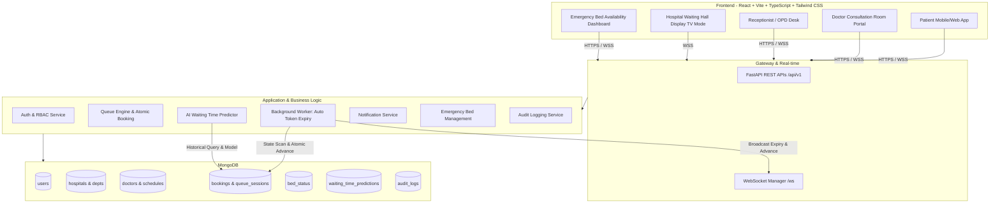
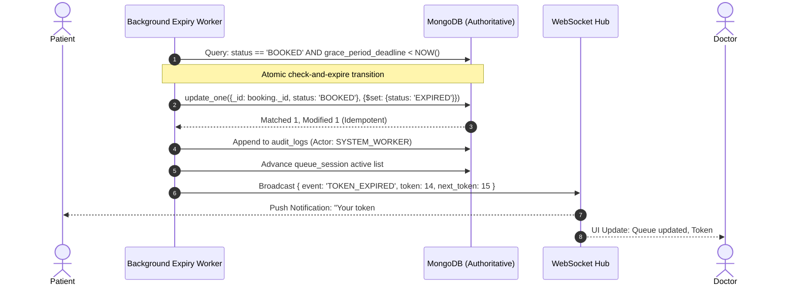

# Hospital OP Live Tracker & Queue Management System
## Architecture Specification & Phased Implementation Plan

---

### Executive Summary
The **Hospital OP Live Tracker** is a mission-critical healthcare application designed to eliminate chaotic outpatient waiting crowds, prevent queue fraud/duplicate bookings, automate patient check-ins and token expiry, provide transparent AI-assisted waiting time forecasts, and deliver real-time live queue tracking for patients, doctors, and hospital administrators.

---

## 1. System Architecture Overview



---

## 2. Technology Stack & Component Responsibilities

| Tier | Technology | Key Libraries / Frameworks | Core Responsibility |
| :--- | :--- | :--- | :--- |
| **Frontend** | React 19 + TypeScript | Vite, Tailwind CSS, Lucide React, Recharts, React Router v7, React Hook Form, Zod, Axios | Sleek, glassmorphism UI for Patient Portal, Doctor OPD Console, Waiting Hall TV Mode, Bed Live Tracker, Token Booking |
| **Backend** | Python 3.12 | FastAPI, Pydantic v2, Uvicorn, Motor/PyMongo, Python-Jose (JWT), Passlib (Bcrypt) | REST API `/api/v1`, service/repository pattern, atomic booking, concurrency control, server-authoritative queue |
| **Database** | MongoDB | Local Mongo / MongoDB Atlas, PyMongo / Async Driver | Compound unique indexes, atomic `$inc` and `$set`, ACID multi-document transactions where applicable |
| **Real-Time** | WebSockets | Native FastAPI WebSocket Manager with Heartbeats | Broadcast token calls, doctor delays, queue position drops, token expirations, and bed updates |
| **Background Worker** | Python Asyncio | Asyncio Worker with Persistent Heartbeat & Restart Recovery | Server-side expiry checking (reporting deadline + grace period), atomic token expiration, queue advancement |
| **AI / ML** | Python | scikit-learn, NumPy, pandas | Transparent baseline heuristic (dynamic queue length $\times$ doctor pace) + trained regression model with fallback |
| **Testing** | pytest & Vitest | pytest-asyncio, HTTPX, Vitest, Testing Library | Strict verification of concurrency, duplicate token prevention, deadline boundaries, and restart recovery |

---

## 3. Database Schema & Collections Design

### 3.1 Core Collections & Indexes

1. **`users`**
   - Fields: `_id`, `name`, `phone`, `email`, `hashed_password`, `role` (`PATIENT`, `DOCTOR`, `RECEPTIONIST`, `ADMIN`), `hospital_id`, `created_at`
   - Indexes: `{ phone: 1 }` (unique), `{ email: 1 }` (sparse unique)

2. **`hospitals` & `departments`**
   - Fields: `_id`, `name`, `code`, `address`, `contact_number`, `departments: [{ id, name, opd_room, active_doctors }]`

3. **`doctors` & `op_schedules`**
   - Fields: `_id`, `hospital_id`, `department_id`, `name`, `specialization`, `avg_consultation_time_min`, `schedule: [{ day, start_time, end_time, slot_duration_min, max_tokens, grace_period_min }]`

4. **`bookings`**
   - Fields: `_id`, `booking_ref` (e.g., `OP-20261024-CARD-014`), `patient_id`, `patient_name`, `patient_phone`, `patient_age`, `patient_gender`, `doctor_id`, `department_id`, `schedule_id`, `booking_date`, `token_number`, `booking_type` (`ONLINE`, `OFFLINE_WALKIN`), `status` (`BOOKED`, `CHECKED_IN`, `IN_CONSULTATION`, `COMPLETED`, `EXPIRED`, `CANCELLED`, `NO_SHOW`), `reporting_deadline`, `grace_period_deadline`, `check_in_time`, `consultation_start_time`, `consultation_end_time`, `created_at`
   - **Crucial Unique Indexes:**
     - `{ schedule_id: 1, booking_date: 1, token_number: 1 }` -> **Prevents duplicate token numbers!**
     - `{ schedule_id: 1, booking_date: 1, patient_phone: 1, status: 1 }` -> Prevents duplicate active bookings for the same patient in the same session.

5. **`queue_sessions`**
   - Fields: `_id`, `schedule_id`, `doctor_id`, `date`, `session_status` (`SCHEDULED`, `RUNNING`, `PAUSED`, `CONCLUDED`), `current_serving_token`, `last_called_time`, `total_booked`, `total_completed`, `total_expired`, `active_queue_tokens: []`

6. **`bed_status`**
   - Fields: `_id`, `hospital_id`, `category` (`ICU`, `EMERGENCY_TRAUMA`, `OXYGEN_SUPPORT`, `GENERAL_WARD`, `PEDIATRIC`), `total_beds`, `occupied_beds`, `available_beds`, `last_updated_by`, `updated_at`

7. **`waiting_time_predictions`**
   - Fields: `_id`, `booking_id`, `doctor_id`, `queue_position`, `predicted_wait_minutes`, `confidence_interval_min`, `prediction_type` (`BASELINE_HEURISTIC` vs `ML_REGRESSION`), `generated_at`

8. **`audit_logs`**
   - Fields: `_id`, `entity_type` (`BOOKING`, `QUEUE`, `BED`, `EXPIRY_WORKER`), `entity_id`, `action`, `actor_id` (or `SYSTEM_WORKER`), `previous_state`, `new_state`, `reason`, `timestamp`

---

## 4. Automatic Token Expiry & Queue Advancement Algorithm



### Key Engineering Safeguards:
1. **Server-Authoritative Clock:** Strictly use UTC/Server timestamps; no client-side clock trust.
2. **Atomic Ineligibility Filter:** Tokens in `CHECKED_IN`, `IN_CONSULTATION`, `COMPLETED`, or already `EXPIRED` are never touched.
3. **Double-Expiry Prevention:** Database query requires `status == 'BOOKED'` inside the atomic update operation.
4. **Crash Recovery:** When the FastAPI server or background worker restarts, a startup hook scans all active sessions for overdue tokens and catches up immediately.

---

## 5. UI/UX Design System (Hospital OP Live Tracker)

1. **Color Palette:**
   - Primary: Medical Deep Indigo (`#1e3a8a`, `#2563eb`) & Healing Cyan (`#06b6d4`, `#0891b2`)
   - Accent & Status:
     - Serving / Calling: Emerald Green (`#10b981`, pulsing glow)
     - Warning / Grace Period: Amber (`#f59e0b`)
     - Expired: Rose Coral (`#ef4444`)
     - Neutral: Slate Dark Theme (`#0f172a`, `#1e293b`) with crisp typography (Inter/Plus Jakarta Sans)
2. **Display Modes:**
   - **Patient View:** Clean, clear token card with large status badge, live progress ring ("3 patients ahead of you"), reporting countdown timer, and directions.
   - **Doctor Consultation OPD Console:** Quick keyboard shortcuts or single-click buttons: `Call Next Patient`, `Start Consultation`, `Mark Completed`, `Put on Hold (5m)`, `Patient Absent`.
   - **Waiting Hall TV Mode:** High-contrast, full-screen digital signage showing Current Token, Room Number, Doctor Name, and Next 3 Waiting Tokens with audio chime notification.
   - **Emergency Bed Live Bar:** Real-time indicator for critical beds across hospital wards.

---

## 6. Phased Implementation Roadmap

```mermaid
gantt
    title Hospital OP Live Tracker Roadmap
    dateFormat  YYYY-MM-DD
    section Setup & Foundation
    Phase 1: Workspace & Runtime Inspection :done, p1, 2026-10-23, 1d
    Phase 2: Architecture Plan & Review      :active, p2, 2026-10-23, 1d
    section Core Infrastructure
    Phase 3: Foundations (Frontend + Backend + DB) : p3, 2026-10-23, 1d
    Phase 4: Independent Connection Verification   : p4, 2026-10-23, 1d
    section Core Queue Engine
    Phase 5: Auth, Hospital Data & Reliable Booking Queue : p5, 2026-10-24, 1d
    Phase 6: Auto Token Expiry, Grace & WebSockets : p6, 2026-10-24, 1d
    section Intelligence & Polish
    Phase 7: AI Waiting Time & Emergency Beds      : p7, 2026-10-25, 1d
    Phase 8: Comprehensive Tests & Verification    : p8, 2026-10-25, 1d
```

### Detailed Phase Breakdown:

* **Phase 1: Workspace & Runtime Inspection (Completed)**
  - Inspected `d:\op patient waiting management system`.
  - Confirmed Node.js `v24.19.0`, npm `11.17.0`, winget `v1.29.380`.
  - Identified Python setup requirement (installing Python 3.12 via winget/isolated virtual environment).
* **Phase 2: Architecture & Implementation Plan (Current)**
  - Finalized tech stack, DB schemas, atomic concurrency patterns, background worker architecture, and UI/UX design tokens.
* **Phase 3: Foundational Scaffolding**
  - Initialize `frontend/` with Vite + React 19 + TypeScript + Tailwind CSS + Lucide + Recharts.
  - Initialize `backend/` with FastAPI + Pydantic v2 + Uvicorn + Motor/PyMongo + CORS + clean repository structure.
  - Configure `.env.example`, `README.md`, and local developer scripts.
* **Phase 4: Independent Verification**
  - Run frontend dev server on port 5173.
  - Run backend FastAPI server on port 8000 with `/api/v1/health`.
  - Verify DB connectivity and health checks independently.
* **Phase 5: Reliable Booking & Queue Engine (High Priority Core)**
  - Implement JWT authentication & role-based middleware (`PATIENT`, `DOCTOR`, `RECEPTIONIST`, `ADMIN`).
  - Hospital, department, doctor, and OP schedule seed data.
  - Atomic token generation: online patient booking and offline walk-in booking with zero duplicate token guarantee.
  - Patient queue view & Doctor consultation console.
* **Phase 6: Automatic Token Expiry, Grace Periods & Real-Time WebSockets**
  - Implement the background asyncio worker with configurable grace period (e.g. 10 mins).
  - Atomic transition: `BOOKED` -> `EXPIRED` if not checked in by deadline.
  - Automatic queue advancement & audit logging.
  - WebSocket hub for live token announcements and audio/visual chimes.
* **Phase 7: AI Waiting Time Predictions & Emergency Bed Availability**
  - Baseline transparent queue calculation engine.
  - scikit-learn regression model integration with fallback heuristics.
  - Emergency bed dashboard (ICU, Emergency, Oxygen, General Ward live updates).
* **Phase 8: Testing, Polish & Documentation**
  - Backend integration tests with `pytest` (concurrent booking tests, token expiry edge cases, grace period boundaries).
  - Frontend component tests with Vitest.
  - Full application walkthrough demonstration and documentation.
