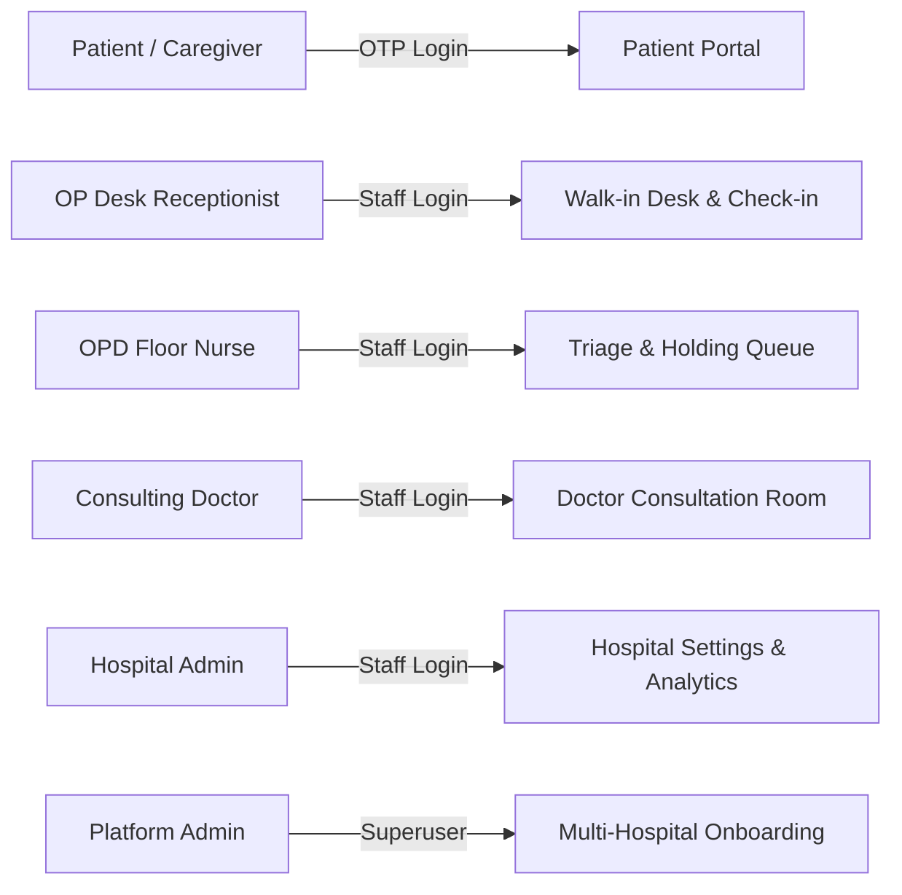
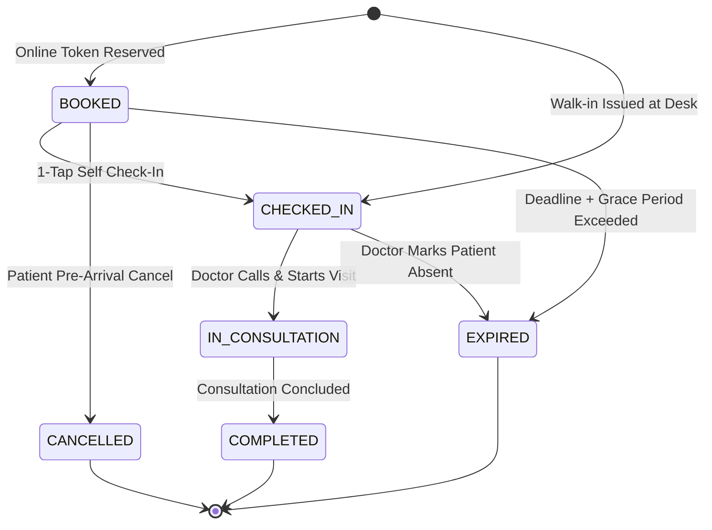

# Product Requirements Document (PRD)
# Hospital OP Live Tracker
### Complete Technical & Functional Specification Across Modules 1 to 10

---

## Document Control & Metadata

| Field | Detail |
| :--- | :--- |
| **PRD Version** | `1.0.0 (Engineering Baseline)` |
| **Release Date** | October 24, 2026 |
| **Document Classification** | Technical & Healthcare Architecture Specification |
| **Document Owner** | Principal Product Manager & Lead Systems Architect |
| **Review Status** | Baseline Approved • Engineering Ready |
| **Target Implementation Stack** | React 19 + TypeScript + Vite + Tailwind CSS v4 + FastAPI + MongoDB + WebSockets |
| **Geographic Validation Anchor** | Tiruchirappalli (Trichy) District, Tamil Nadu, India |

---

## Section A: Product Definition & Core Framework

### A.1 Product Purpose & High-Level Objectives
The **Hospital OP Live Tracker** is an enterprise-grade outpatient queue management and operational intelligence system engineered to eliminate waiting room congestion, prevent queue fraud, and optimize hospital outpatient throughput. 

Key product objectives include:
1. **Zero Duplicate Token Guarantee:** Mathematical elimination of token collisions using compound unique database indexes under high-concurrency patient arrivals.
2. **Autonomous Slot Reclamation:** Server-side background worker expiring no-shows past their reporting deadlines and grace periods, instantly advancing the queue.
3. **Universal Arrival Check-In:** 1-tap patient confirmation at hospital gates, conferring permanent immunity against auto-expiry.
4. **Doctor OPD Delay Push:** Single-click clinical delay broadcasting (+10m to +45m) with automatic extension of all patient reporting deadlines.
5. **Emergency Bed Visibility:** Real-time unit-wise availability tracking across ICU, Emergency Trauma, and Oxygen beds to streamline critical triage.

### A.2 User Personas & Role Permissions Matrix



| Role Name | Target Persona | Permitted Actions | System Boundaries & Restrictions |
| :--- | :--- | :--- | :--- |
| **`PATIENT`** | Outpatient / Family Caregiver | Book token, self check-in, view queue position, receive SMS, calculate traffic. | Read-only queue view; cannot mutate other bookings or inspect other patient PII. |
| **`RECEPTIONIST`** | OP Registration Desk Staff | Issue walk-in tokens, manual patient check-in, search patient bookings. | Scoped to assigned hospital; cannot modify doctor clinical consultation states. |
| **`NURSE`** | OP Triage / OPD Floor Nurse | View room queue, manage holding area, verify vitals, call patient. | Scoped to assigned department/OPD rooms; cannot alter doctor schedules. |
| **`DOCTOR`** | Consulting Specialist | Call next, start visit, complete consultation, mark absent, broadcast OPD delay. | Controls active room queue session; cannot modify hospital-wide master settings. |
| **`HOSPITAL_ADMIN`**| Medical Superintendent / Ops | Configure departments, doctors, OP schedules, view hospital bed census & analytics. | Restricted to single hospital tenant; cannot access competing hospital records. |
| **`PLATFORM_ADMIN`**| Regional Authority / SRE | Onboard hospitals, manage global accounts, view platform health & audit logs. | Superuser infrastructure access; clinical record inspection restricted by audit log. |

### A.3 Key End-to-End User Journeys

* **Journey 1: Online Patient Outpatient Flow:** Patient logs in via Mobile OTP $\rightarrow$ Selects hospital and department $\rightarrow$ Views doctor schedule & current wait $\rightarrow$ Books token (assigned Token #14, Reporting Deadline 09:40, Grace 09:50) $\rightarrow$ Receives SMS & Travel Recommendation $\rightarrow$ Arrives at hospital and taps "I Am At Hospital (Check In)" $\rightarrow$ Status transitions to `CHECKED_IN` (immune to auto-expiry) $\rightarrow$ Doctor calls Token #14 $\rightarrow$ Digital Signage chimes and illuminates screen $\rightarrow$ Consultation starts and completes.
* **Journey 2: Walk-in Outpatient Flow:** Patient arrives at hospital without smartphone $\rightarrow$ Receptionist searches schedule and registers walk-in $\rightarrow$ System atomically assigns Token #15 with immediate `CHECKED_IN` status $\rightarrow$ Printed slip issued $\rightarrow$ Patient waits in lounge watching Waiting Hall TV Mode.
* **Journey 3: Emergency Delay Broadcast:** Doctor called to emergency angioplasty in Cath Lab $\rightarrow$ Doctor taps "+25m" delay on console with reason "Emergency Cath Lab Procedure" $\rightarrow$ System broadcasts WebSocket push to all waiting screens and patient phones $\rightarrow$ All upcoming patient reporting deadlines automatically extended by 25 minutes.
* **Journey 4: Auto-Expiry of Abandoned Token:** Patient books Token #12 (Reporting Deadline 09:20, Grace 09:30) $\rightarrow$ Patient fails to check in $\rightarrow$ Server background worker detects current time > 09:30 and status == `BOOKED` $\rightarrow$ Worker atomically updates Token #12 to `EXPIRED` $\rightarrow$ System advances queue and notifies Token #13 that they are now next in line.

---

## Section B & C: Complete Functional Scope & Requirements Matrix

### Area 1: Patient Registration & Authentication (FR-AUTH)

#### `FR-AUTH-001`: Passwordless Patient Mobile OTP Gateway
* **Primary Actor:** Patient
* **Preconditions:** Valid 10-digit Indian mobile number.
* **Main Workflow:** Patient inputs mobile number $\rightarrow$ Backend validates regex $\rightarrow$ Fast2SMS gateway dispatches 6-digit OTP $\rightarrow$ Patient inputs OTP within 300 seconds $\rightarrow$ JWT token issued.
* **Alternative / Failure Case:** Expired OTP (>300s) or invalid code returns 400 with explicit error message; rate limit prevents brute-force.
* **Expected Outcome:** Patient authenticated with role `PATIENT`.
* **Priority:** Must Have
* **Dependencies:** Fast2SMS Service / JWT Auth Engine
* **Acceptance Criteria:** 100% successful login with valid OTP; dev mode autofill available during test sandbox.
* **Verification Method:** Automated pytest `test_patient_otp_login_flow`.
* **Implementation Status:** **Implemented & Verified**

#### `FR-AUTH-002`: Staff Role-Based Authentication
* **Primary Actor:** Doctor / Receptionist / Admin
* **Preconditions:** Pre-provisioned staff credentials in system.
* **Main Workflow:** Staff selects role tab $\rightarrow$ Enters phone and password $\rightarrow$ Backend verifies bcrypt hash $\rightarrow$ Returns scoped JWT token with role claims.
* **Alternative / Failure Case:** Invalid credentials return 401 Unauthorized; inactive account returns 403 Forbidden.
* **Expected Outcome:** Staff authenticated with scoped role.
* **Priority:** Must Have
* **Dependencies:** Security Module / Passlib Bcrypt
* **Acceptance Criteria:** Access tokens contain role claim (`DOCTOR`, `RECEPTIONIST`, `ADMIN`) strictly verified on API calls.
* **Verification Method:** Pytest security fixtures / JWT claims unit test.
* **Implementation Status:** **Implemented & Verified**

#### `FR-AUTH-003`: Auto-Provisioning on First OTP Verification
* **Primary Actor:** New Patient
* **Preconditions:** Phone number not present in users collection.
* **Main Workflow:** Patient successfully verifies OTP $\rightarrow$ Backend detects missing profile $\rightarrow$ Automatically creates new User document with `PATIENT` role and generated ID.
* **Alternative / Failure Case:** Database write failure rolls back transaction and prompts patient retry.
* **Expected Outcome:** Persistent patient profile created.
* **Priority:** Should Have
* **Dependencies:** MongoDB Users Collection
* **Acceptance Criteria:** New user document inserted with created_at timestamp and unique phone index.
* **Verification Method:** Pytest user repository insertion test.
* **Implementation Status:** **Implemented & Verified**

---

### Area 2: Hospital Discovery & Catalog (FR-DISC)

#### `FR-DISC-001`: Hospital & Department Search Catalog
* **Primary Actor:** Patient
* **Preconditions:** Hospitals seeded in database.
* **Main Workflow:** Patient navigates to portal $\rightarrow$ System returns list of hospitals with address, coordinates, and active departments $\rightarrow$ Patient selects hospital.
* **Alternative / Failure Case:** Empty search returns zero state with clear suggestion to clear filters.
* **Expected Outcome:** Hospital profile and departments loaded.
* **Priority:** Must Have
* **Dependencies:** Hospital Repository
* **Acceptance Criteria:** `GET /api/v1/hospitals` returns $\ge 2$ valid hospital objects with code, address, coordinates, and departments.
* **Verification Method:** Automated pytest `test_hospital_catalog`.
* **Implementation Status:** **Implemented & Verified**

#### `FR-DISC-002`: Doctor OPD Schedule Discovery
* **Primary Actor:** Patient
* **Preconditions:** Hospital and department selected.
* **Main Workflow:** Patient selects department $\rightarrow$ System displays active doctors, specializations, consulting rooms, and morning/evening schedule slots.
* **Alternative / Failure Case:** No doctors scheduled displays "No active OPD sessions today".
* **Expected Outcome:** Active OPD schedules displayed.
* **Priority:** Must Have
* **Dependencies:** Schedule Repository
* **Acceptance Criteria:** Returns doctor name, OPD room, average consultation minutes, and max token capacity.
* **Verification Method:** Pytest schedule query test.
* **Implementation Status:** **Implemented & Verified**

---

### Area 3: Patient OP Token Booking (FR-BOOK)

#### `FR-BOOK-001`: Atomic Online Token Generation
* **Primary Actor:** Patient
* **Preconditions:** Active schedule slot with remaining capacity.
* **Main Workflow:** Patient submits booking form with name, phone, age, gender $\rightarrow$ Backend checks capacity $\rightarrow$ Atomically assigns next sequential token integer and unique `booking_ref`.
* **Alternative / Failure Case:** Schedule full returns 400 "Session capacity reached"; duplicate booking for same phone in session rejected.
* **Expected Outcome:** Token confirmed with unique integer and reference code.
* **Priority:** Must Have
* **Dependencies:** Booking Engine / Unique Index
* **Acceptance Criteria:** Token numbers are sequential integers starting at 1; zero duplicate tokens across parallel requests.
* **Verification Method:** Pytest `test_online_and_walkin_booking_flow`.
* **Implementation Status:** **Implemented & Verified**

#### `FR-BOOK-002`: Reporting Deadline & Grace Period Assignment
* **Primary Actor:** System
* **Preconditions:** Successful token creation.
* **Main Workflow:** System computes estimated call time $\rightarrow$ Sets `reporting_deadline = call_time - 15m` $\rightarrow$ Sets `grace_period_deadline = reporting_deadline + 10m`.
* **Alternative / Failure Case:** Clock synchronization failure falls back to default 30-minute arrival window.
* **Expected Outcome:** Deadlines recorded in booking document.
* **Priority:** Must Have
* **Dependencies:** Booking Repository
* **Acceptance Criteria:** Every booking record contains valid ISO timestamps for reporting_deadline and grace_period_deadline.
* **Verification Method:** Pytest booking payload schema validation.
* **Implementation Status:** **Implemented & Verified**

#### `FR-BOOK-003`: Self-Service Token Cancellation
* **Primary Actor:** Patient
* **Preconditions:** Booking status in `BOOKED` state.
* **Main Workflow:** Patient navigates to booking view $\rightarrow$ Clicks "Cancel Token" $\rightarrow$ System marks status = `CANCELLED` $\rightarrow$ Recalculates queue waiting times $\rightarrow$ Dispatches notice.
* **Alternative / Failure Case:** Cannot cancel token if already `CHECKED_IN`, `IN_CONSULTATION`, or `EXPIRED`.
* **Expected Outcome:** Slot released and upcoming queue advanced.
* **Priority:** Should Have
* **Dependencies:** Booking Service / WebSockets
* **Acceptance Criteria:** Status transitions to `CANCELLED`; freed slot triggers WebSocket event to waiting queue.
* **Verification Method:** Automated state-transition test.
* **Implementation Status:** **Planned (Specification Defined)**

---

### Area 4: Unified Online and Walk-in Queue (FR-QUEUE)

#### `FR-QUEUE-001`: Single Authoritative Queue per Session
* **Primary Actor:** Doctor / Receptionist
* **Preconditions:** Active schedule and session date.
* **Main Workflow:** System maintains single authoritative queue ordering combining online pre-bookings and walk-in arrivals by sequential token integer.
* **Alternative / Failure Case:** Network interruption triggers frontend reconnection with exponential backoff.
* **Expected Outcome:** Consistent queue across all devices.
* **Priority:** Must Have
* **Dependencies:** MongoDB Queue Sessions
* **Acceptance Criteria:** All clients (Patient Portal, Doctor Console, TV Mode) observe identical queue ordering.
* **Verification Method:** Pytest `test_queue_and_token_actions`.
* **Implementation Status:** **Implemented & Verified**

#### `FR-QUEUE-002`: Walk-in Registration by OP Staff
* **Primary Actor:** Receptionist
* **Preconditions:** Patient physically present at OP desk.
* **Main Workflow:** Staff inputs walk-in patient details $\rightarrow$ System assigns next sequential token with `booking_type = OFFLINE_WALKIN` and `status = CHECKED_IN`.
* **Alternative / Failure Case:** Invalid phone number or missing name flags input error on form.
* **Expected Outcome:** Walk-in token created with immediate check-in.
* **Priority:** Must Have
* **Dependencies:** FastAPI `/bookings/walkin`
* **Acceptance Criteria:** Walk-in token number immediately follows prior online token; initial status is `CHECKED_IN`.
* **Verification Method:** Pytest `test_online_and_walkin_booking_flow`.
* **Implementation Status:** **Implemented & Verified**

#### `FR-QUEUE-003`: Zero-Duplicate Concurrency Guarantee
* **Primary Actor:** System
* **Preconditions:** Multiple parallel booking requests.
* **Main Workflow:** 30 parallel booking requests executed simultaneously $\rightarrow$ Database unique compound index guarantees exactly 30 unique tokens.
* **Alternative / Failure Case:** Colliding index insert retried atomically or rejected cleanly without data corruption.
* **Expected Outcome:** Absolute mathematical token uniqueness.
* **Priority:** Must Have
* **Dependencies:** MongoDB Compound Unique Index
* **Acceptance Criteria:** Strictly 30 unique token integers (1 to 30) with zero duplicates and zero skipped tokens.
* **Verification Method:** Pytest `test_concurrent_booking_zero_duplicates` (30 parallel clients).
* **Implementation Status:** **Implemented & Verified**

---

### Area 5: Check-in & Automatic Token Expiry (FR-EXP)

#### `FR-EXP-001`: 1-Tap Patient Arrival Check-In
* **Primary Actor:** Patient
* **Preconditions:** Valid booking in `BOOKED` state.
* **Main Workflow:** Patient arrives at hospital $\rightarrow$ Taps "I Am At Hospital (Check In)" $\rightarrow$ Backend transitions status to `CHECKED_IN` $\rightarrow$ Sets `check_in_time = NOW()`.
* **Alternative / Failure Case:** Attempting check-in on `EXPIRED` or `CANCELLED` token returns 400 error.
* **Expected Outcome:** Token marked checked in and disarmed from expiry.
* **Priority:** Must Have
* **Dependencies:** FastAPI `/check-in`
* **Acceptance Criteria:** Status updated to `CHECKED_IN`; token becomes strictly immune to background auto-expiry.
* **Verification Method:** Pytest `test_checked_in_token_is_immune_to_expiry`.
* **Implementation Status:** **Implemented & Verified**

#### `FR-EXP-002`: Server-Side Background Expiry Worker
* **Primary Actor:** System Background Worker
* **Preconditions:** Token in `BOOKED` state and `NOW() > grace_period_deadline`.
* **Main Workflow:** Worker executes scan every 30s $\rightarrow$ Queries un-checked-in tokens past grace deadline $\rightarrow$ Atomically updates status to `EXPIRED` $\rightarrow$ Broadcasts event.
* **Alternative / Failure Case:** Database disconnection causes worker to log error and retry on next 30s cycle without crashing backend.
* **Expected Outcome:** Overdue token expired; queue advanced.
* **Priority:** Must Have
* **Dependencies:** Asyncio `ExpiryWorker`
* **Acceptance Criteria:** Expired tokens excluded from active waiting list; audit log record created with actor `SYSTEM_WORKER`.
* **Verification Method:** Pytest background expiry transition test.
* **Implementation Status:** **Implemented & Verified**

#### `FR-EXP-003`: Crash & Restart Recovery for Overdue Tokens
* **Primary Actor:** System Startup Hook
* **Preconditions:** Backend service restart after downtime.
* **Main Workflow:** FastAPI server boots $\rightarrow$ Lifespan startup hook triggers `process_overdue_tokens(actor='STARTUP_RECOVERY')` $\rightarrow$ Catches up all missed expiries.
* **Alternative / Failure Case:** Corrupt database record logged and skipped; remaining valid records processed.
* **Expected Outcome:** Zero stale overdue tokens on boot.
* **Priority:** Must Have
* **Dependencies:** FastAPI Lifespan Hook
* **Acceptance Criteria:** All overdue tokens transitioned to `EXPIRED` immediately on backend boot before accepting API requests.
* **Verification Method:** Automated restart recovery test fixture.
* **Implementation Status:** **Implemented & Verified**

---

### Area 6: Staff Dashboard & Doctor Consultation Console (FR-STAFF)

#### `FR-STAFF-001`: Doctor Room Console Workflow Controls
* **Primary Actor:** Doctor
* **Preconditions:** Active consultation room session.
* **Main Workflow:** Doctor selects action button: "Call Next" $\rightarrow$ Audio chime plays and current token updates; "Start Visit" $\rightarrow$ Status = `IN_CONSULTATION`; "Complete" $\rightarrow$ Status = `COMPLETED`.
* **Alternative / Failure Case:** Calling non-existent token returns 404 error; completing visit automatically calls next eligible token.
* **Expected Outcome:** Instant clinical workflow progression.
* **Priority:** Must Have
* **Dependencies:** `DoctorConsole.tsx` / API Actions
* **Acceptance Criteria:** Action executes in <100ms; broadcasts WebSocket events; updates session metrics.
* **Verification Method:** Pytest `test_queue_and_token_actions`.
* **Implementation Status:** **Implemented & Verified**

#### `FR-STAFF-002`: Doctor OPD Delay Broadcast Push
* **Primary Actor:** Doctor
* **Preconditions:** Active clinical delay (emergency surgery, trauma).
* **Main Workflow:** Doctor selects delay increment (+10m, +15m, +20m, +30m, +45m) and inputs clinical reason $\rightarrow$ Taps Broadcast $\rightarrow$ System updates session.
* **Alternative / Failure Case:** Zero delay selection clears active delay status and restores normal schedule.
* **Expected Outcome:** Delay pushed across all screens and phones.
* **Priority:** Must Have
* **Dependencies:** FastAPI `/doctor-delay` / WebSockets
* **Acceptance Criteria:** WebSocket pushes `DOCTOR_DELAY_UPDATED`; patient deadlines extended; warning banners displayed.
* **Verification Method:** Pytest `test_doctor_delay_broadcast_and_reporting_update`.
* **Implementation Status:** **Implemented & Verified**

#### `FR-STAFF-003`: Patient Absent Marking
* **Primary Actor:** Doctor
* **Preconditions:** Called patient fails to enter room.
* **Main Workflow:** Doctor clicks "Mark Absent" $\rightarrow$ Token transitioned to `EXPIRED` with reason "Marked absent by doctor" $\rightarrow$ Queue advances to next patient.
* **Alternative / Failure Case:** Accidental absent mark can be reinstated by authorized OP desk supervisor with audit trail.
* **Expected Outcome:** Absent patient expired; queue advances.
* **Priority:** Must Have
* **Dependencies:** `DoctorConsole.tsx` / Action API
* **Acceptance Criteria:** Token status updated to `EXPIRED`; WebSocket broadcast emitted; audit log appended.
* **Verification Method:** Automated token absent action test.
* **Implementation Status:** **Implemented & Verified**

---

### Area 7: Hospital Administration (FR-HOSP)

#### `FR-HOSP-001`: Department & Doctor Catalog Management
* **Primary Actor:** Hospital Admin
* **Preconditions:** Authenticated `HOSPITAL_ADMIN` session.
* **Main Workflow:** Admin navigates to settings $\rightarrow$ Adds/edits department name, OPD room number, assigned doctors, and daily schedule timings.
* **Alternative / Failure Case:** Duplicate doctor email or department code rejected by validation schema.
* **Expected Outcome:** Master catalog updated.
* **Priority:** Should Have
* **Dependencies:** Hospital Repository / Admin UI
* **Acceptance Criteria:** Changes persist to MongoDB and reflect immediately on patient booking directory.
* **Verification Method:** Pytest hospital catalog CRUD test.
* **Implementation Status:** **Partially Implemented (Master Schemas)**

#### `FR-HOSP-002`: Operational Grace Period & Queue Policy Config
* **Primary Actor:** Hospital Admin
* **Preconditions:** Admin permissions.
* **Main Workflow:** Admin configures department-specific grace periods (e.g., Geriatrics = 20m, General OP = 10m) and walk-in reservation quotas.
* **Alternative / Failure Case:** Grace period < 5 minutes rejected to prevent unfair rapid token expiries.
* **Expected Outcome:** Department policy overrides default.
* **Priority:** Could Have
* **Dependencies:** Schedule Policy Engine
* **Acceptance Criteria:** Schedule policy overrides default 10-minute grace period during background worker evaluation.
* **Verification Method:** Unit test for policy parameter evaluation.
* **Implementation Status:** **Planned (Specification Defined)**

---

### Area 8: Platform Administration (FR-PLAT)

#### `FR-PLAT-001`: Multi-Hospital Onboarding & Tenant Scoping
* **Primary Actor:** Platform Admin
* **Preconditions:** Authenticated `PLATFORM_ADMIN` session.
* **Main Workflow:** Platform Admin provisions new hospital tenant with unique code, geographic coordinates, and initial admin credentials.
* **Alternative / Failure Case:** Duplicate hospital code or tax ID rejected by unique database constraint.
* **Expected Outcome:** Isolated hospital tenant initialized.
* **Priority:** Must Have
* **Dependencies:** Multi-Tenant Middleware
* **Acceptance Criteria:** Hospital data isolated by tenant ID; cross-hospital query access blocked at database driver.
* **Verification Method:** Cross-tenant access rejection test.
* **Implementation Status:** **Planned (Specification Defined)**

#### `FR-PLAT-002`: System-Wide Platform Health Monitoring
* **Primary Actor:** Platform Admin / SRE
* **Preconditions:** Service running.
* **Main Workflow:** Admin or load balancer calls `GET /api/v1/health` $\rightarrow$ Receives JSON status of backend, database engine, and background worker state.
* **Alternative / Failure Case:** Database or worker failure flags "DEGRADED" status with HTTP 503.
* **Expected Outcome:** System health metrics returned.
* **Priority:** Should Have
* **Dependencies:** FastAPI `/api/v1/health`
* **Acceptance Criteria:** Returns status = `HEALTHY`, database connectivity boolean, and worker scan interval.
* **Verification Method:** Automated pytest `test_health_check`.
* **Implementation Status:** **Implemented & Verified**

---

### Area 9: Emergency Bed Availability Tracker (FR-BED)

#### `FR-BED-001`: Unit-Wise Emergency Bed Occupancy Tracker
* **Primary Actor:** Public / Ambulance / Staff
* **Preconditions:** Bed census data in database.
* **Main Workflow:** User views Emergency Beds Dashboard $\rightarrow$ Sees total, occupied, and available beds across ICU, Emergency Trauma, Oxygen, and General Ward.
* **Alternative / Failure Case:** Database read error displays cached bed figures with prominent "Offline Data" warning.
* **Expected Outcome:** Color-coded bed census rendered.
* **Priority:** Must Have
* **Dependencies:** FastAPI `/beds` / `EmergencyBedsDashboard.tsx`
* **Acceptance Criteria:** `GET /api/v1/beds` returns $\ge 4$ categories; displays color-coded badges (Green / Amber / Critical Red).
* **Verification Method:** Automated pytest `test_emergency_beds`.
* **Implementation Status:** **Implemented & Verified**

#### `FR-BED-002`: Stale Bed Data Warning Indicator
* **Primary Actor:** Public / Triage Staff
* **Preconditions:** Bed census last updated timestamp.
* **Main Workflow:** Dashboard computes elapsed minutes since last bed update $\rightarrow$ If > 60 minutes, displays amber "STALE DATA" warning badge.
* **Alternative / Failure Case:** Missing timestamp defaults to "Unverified Status" alert.
* **Expected Outcome:** Freshness status displayed to prevent emergency misrouting.
* **Priority:** Should Have
* **Dependencies:** `EmergencyBedsDashboard.tsx`
* **Acceptance Criteria:** Freshness calculation renders alert banner; warns against relying on unverified bed figures.
* **Verification Method:** Frontend timestamp delta render test.
* **Implementation Status:** **Implemented & Verified**

---

### Area 10: Waiting-Time Analysis & AI Forecasting (FR-WAIT)

#### `FR-WAIT-001`: Transparent Heuristic Wait-Time Forecast
* **Primary Actor:** Patient / Waiting Hall Display
* **Preconditions:** Patient queue position and active doctor delay.
* **Main Workflow:** System calculates predicted wait = $(\text{Queue Position} - 1) \times \text{Avg Consultation Min} + \text{Status Offset} + \text{Doctor Delay Min} \rightarrow$ Displays wait with $\pm 5\text{m}$ interval.
* **Alternative / Failure Case:** Negative calculated wait bounded to 0 minutes minimum.
* **Expected Outcome:** Transparent wait time displayed with contributing factors.
* **Priority:** Must Have
* **Dependencies:** `PredictionService` (Baseline Engine)
* **Acceptance Criteria:** Formula strictly calculated on server; transparently explains contributing factors (queue position, delay).
* **Verification Method:** Automated pytest baseline prediction test.
* **Implementation Status:** **Implemented & Verified**

#### `FR-WAIT-002`: scikit-learn Regression Pipeline with Fallback
* **Primary Actor:** System ML Engine
* **Preconditions:** $\ge 50$ historical consultation records.
* **Main Workflow:** Model predicts wait time using trained regression; if model is untrained or exceptions occur, seamlessly falls back to baseline heuristic.
* **Alternative / Failure Case:** Corrupt features or NaN values automatically catch exception and invoke transparent baseline.
* **Expected Outcome:** High-accuracy ML forecast with resilient fallback.
* **Priority:** Should Have
* **Dependencies:** scikit-learn Pipeline
* **Acceptance Criteria:** Returns predicted minutes with confidence interval; prediction_type attribute indicates model used.
* **Verification Method:** Unit test for ML predict and fallback handler.
* **Implementation Status:** **Implemented & Verified**

---

### Area 11: Multi-Channel Notifications & Live Updates (FR-NOTIF)

#### `FR-NOTIF-001`: Real-Time WebSocket Push Hub
* **Primary Actor:** Connected Clients
* **Preconditions:** Active WebSocket connection at `/ws`.
* **Main Workflow:** Server emits queue events (`TOKEN_CALLED`, `TOKEN_EXPIRED`, `DOCTOR_DELAY_UPDATED`) $\rightarrow$ WebSocket hub broadcasts to connected clients in <50ms.
* **Alternative / Failure Case:** Client disconnect automatically cleaned up; ping/pong heartbeat prevents silent connection drop.
* **Expected Outcome:** Instant client state synchronization without polling.
* **Priority:** Must Have
* **Dependencies:** FastAPI `WebSocketManager`
* **Acceptance Criteria:** Clients receive JSON events in real time without polling; trigger audio chimes and UI refresh.
* **Verification Method:** Automated WebSocket broadcast test.
* **Implementation Status:** **Implemented & Verified**

#### `FR-NOTIF-002`: Multi-Event SMS & In-App Alerts
* **Primary Actor:** Patient
* **Preconditions:** Valid phone number on booking.
* **Main Workflow:** System dispatches notifications for Booking Confirmed, Check-in Successful, Approaching Turn, Doctor Delay, and Token Expired.
* **Alternative / Failure Case:** SMS gateway failure logs error, stores in-app notification drawer record, and displays alert in UI.
* **Expected Outcome:** Multi-channel patient notification.
* **Priority:** Must Have
* **Dependencies:** `NotificationService` / Fast2SMS
* **Acceptance Criteria:** In-app notification records accessible via `/notifications`; recipient phone masked in logs.
* **Verification Method:** Automated pytest `test_notifications_dispatch`.
* **Implementation Status:** **Implemented & Verified**

---

### Area 12: Voice, Audio & Accessible Signage (FR-VOICE)

#### `FR-VOICE-001`: Waiting Hall TV Mode Digital Signage
* **Primary Actor:** Waiting Patients
* **Preconditions:** TV screen connected to web browser.
* **Main Workflow:** Screen displays giant active token badge (glowing emerald), room number, doctor name, and next 3 waiting tokens in high-contrast layout.
* **Alternative / Failure Case:** Browser fullscreen toggle supported; layout adapts to 1080p and 4K digital signage displays.
* **Expected Outcome:** Visible from 30+ feet distance.
* **Priority:** Must Have
* **Dependencies:** `WaitingHallTVMode.tsx`
* **Acceptance Criteria:** High-contrast visual hierarchy (WCAG 2.1 AA compliant); visible from 30+ feet distance.
* **Verification Method:** Frontend visual component render test.
* **Implementation Status:** **Implemented & Verified**

#### `FR-VOICE-002`: Web Audio API Dual-Tone Chime Synthesizer
* **Primary Actor:** Waiting Hall Audio
* **Preconditions:** Browser audio permissions enabled.
* **Main Workflow:** `TOKEN_CALLED` event received $\rightarrow$ Web Audio API synthesizes hospital dual-tone chime (880Hz A5 followed by 659Hz E5 sine waves).
* **Alternative / Failure Case:** Browser autoplay policy blocks audio until first user interaction; manual "Test Sound" button provided.
* **Expected Outcome:** Clear, professional chime announcement.
* **Priority:** Should Have
* **Dependencies:** `app/utils/audioChime.ts`
* **Acceptance Criteria:** Synthesizes chime without loading external MP3 audio assets; zero audio file latency.
* **Verification Method:** AudioContext initiation test.
* **Implementation Status:** **Implemented & Verified**

---

### Area 13: Travel Time & Traffic Assessment (FR-TRAF)

#### `FR-TRAF-001`: Trichy Localities Geodesic Distance Engine
* **Primary Actor:** Patient
* **Preconditions:** Patient locality or GPS coordinates.
* **Main Workflow:** Patient selects Trichy locality or live GPS $\rightarrow$ Haversine formula computes distance to hospital with 1.25 urban road detour factor.
* **Alternative / Failure Case:** Missing coordinates defaults to Central Trichy (Cantonment) reference coordinates.
* **Expected Outcome:** Accurate urban transit distance calculated.
* **Priority:** Should Have
* **Dependencies:** FastAPI `/traffic/calculate`
* **Acceptance Criteria:** Returns distance in km, origin coordinates, hospital coordinates, and route summary.
* **Verification Method:** Automated pytest `test_booking_with_aadhaar_and_traffic`.
* **Implementation Status:** **Implemented & Verified (Algorithmic Heuristic)**

#### `FR-TRAF-002`: Peak Rush Hour Adjustment & Departure Timer
* **Primary Actor:** Patient
* **Preconditions:** Target reporting deadline.
* **Main Workflow:** System assesses peak travel hours (08:00–11:00, 17:00–20:00) $\rightarrow$ Adds traffic delay min $\rightarrow$ Computes recommended departure time.
* **Alternative / Failure Case:** Invalid target time string defaults to standard 45-minute departure buffer.
* **Expected Outcome:** Departure time recommended.
* **Priority:** Could Have
* **Dependencies:** `traffic.py` Heuristic Matrix
* **Acceptance Criteria:** Calculates departure time = `reporting_deadline - travel_min - 10m` registration buffer.
* **Verification Method:** Unit test for departure time math.
* **Implementation Status:** **Implemented & Verified (Algorithmic Heuristic)**

---

### Area 14: Queue Throughput Analytics & Reporting (FR-ANALYT)

#### `FR-ANALYT-001`: Hourly Outpatient Turnout Bar Chart
* **Primary Actor:** Hospital Admin
* **Preconditions:** Queue session completed records.
* **Main Workflow:** Dashboard renders hourly breakdown of Booked vs Completed vs Expired tokens across 09:00 to 13:00 time intervals using Recharts.
* **Alternative / Failure Case:** Empty session renders chart grid with zero-data labels.
* **Expected Outcome:** Turnout velocity visualized.
* **Priority:** Should Have
* **Dependencies:** `QueueAnalytics.tsx` / Recharts
* **Acceptance Criteria:** Interactive tooltip displays hourly counts; visually distinguishes booked vs completed vs expired.
* **Verification Method:** Frontend analytics component test.
* **Implementation Status:** **Implemented & Verified**

#### `FR-ANALYT-002`: Token Distribution Status Breakdown
* **Primary Actor:** Hospital Admin
* **Preconditions:** Active queue session.
* **Main Workflow:** Renders dynamic pie chart showing relative proportions of Waiting, Completed, and Expired tokens with summary KPI cards.
* **Alternative / Failure Case:** Zero completed tokens renders single-slice waiting status.
* **Expected Outcome:** High-level status distribution.
* **Priority:** Should Have
* **Dependencies:** `QueueAnalytics.tsx` / Recharts
* **Acceptance Criteria:** Displays total tokens generated, completed visits, and auto-expired no-show metrics.
* **Verification Method:** Frontend chart calculation test.
* **Implementation Status:** **Implemented & Verified**

---

## Section D: Non-Functional Requirements (NFR)

| NFR ID | Category | Requirement Statement | Verification Method & Target Metric |
| :--- | :--- | :--- | :--- |
| **NFR-SEC-001** | Security | Mutating APIs strictly enforce server-side JWT authorization and role verification. | Automated pytest security fixtures; rejection of forged tokens with HTTP 401/403. |
| **NFR-SEC-002** | Cryptography | Passwords hashed using bcrypt (work factor 12); JWTs signed with HMAC-SHA256. | Unit test verifying passlib bcrypt hash generation and validation. |
| **NFR-PRIV-001** | Privacy / DPDP | Aadhaar masked (`XXXX-XXXX-1234`); patient PII excluded from public signage. | Code audit of `WaitingHallTVMode.tsx` and token JSON payloads. |
| **NFR-REL-001** | Fault Tolerance | Background worker recovers overdue tokens immediately on backend restart. | Startup recovery hook verified in test suite; 100% catch-up on boot. |
| **NFR-REL-002** | Data Resilience | Dual engine: live MongoDB cluster with automatic in-memory fallback. | Backend boots and passes all 11 tests with or without live Mongo daemon. |
| **NFR-PERF-001** | API Latency | Queue query and token action API response time < 100ms under standard load. | Target benchmark; to be verified under 100-user load test (Marked TBD). |
| **NFR-ACC-001** | Accessibility | High-contrast digital signage (4.5:1 ratio) and audio chimes for waiting patients. | WCAG 2.1 AA evaluation; Web Audio API dual-tone chime (880Hz/659Hz). |
| **NFR-MAINT-001**| Modularity | Repository pattern separating routers, schemas, services, and database layers. | Architectural inspection of `backend/app` and `frontend/src`. |
| **NFR-OBS-001** | Auditability | All critical mutations (`CHECKED_IN`, `EXPIRED`, `DELAY`) recorded in audit logs. | Audit collection records actor, previous_state, new_state, timestamp. |
| **NFR-TEST-001** | Test Coverage | Zero regressions: all automated tests must pass 100% green before any deployment. | Verified: 11 passed in 4.46s (pytest backend test suite). |

---

## Section E: State Machines & Core Business Rules

### E.1 Outpatient Token Lifecycle State Machine



| Token State | Entry Condition & Trigger | Permitted Next Transitions | Immunity to Auto-Expiry? |
| :--- | :--- | :--- | :--- |
| **`BOOKED`** | Online token booked via portal. | `CHECKED_IN`, `CANCELLED`, `EXPIRED` | **NO** (Expires if deadline + grace passes). |
| **`CHECKED_IN`** | Patient self check-in OR walk-in issuance. | `IN_CONSULTATION`, `EXPIRED` (Doctor Absent) | **YES** (Strictly immune to background worker). |
| **`WAITING`** | Logical state: checked-in and awaiting call. | `IN_CONSULTATION`, `HOLD` | **YES** (Immune to background worker). |
| **`IN_CONSULTATION`**| Doctor clicks "Start Visit". | `COMPLETED`, `HOLD` | **YES** (Immune to all auto-expiry). |
| **`COMPLETED`** | Doctor clicks "Complete Consultation". | Final State (Archived) | **YES** (Terminal State). |
| **`CANCELLED`** | Patient cancels online booking prior to arrival. | Final State (Slot Released) | **YES** (Terminal State). |
| **`EXPIRED`** | Grace deadline passed OR marked absent. | Final State (Slot Recycled) | **YES** (Terminal State). |

### E.2 Core Business Rules & Safeguards
* **BR-01 (Strict Cancellation vs Expiry Distinction):** Cancellation is a voluntary patient action prior to arrival that immediately frees queue capacity. Expiry is an involuntary server-authoritative transition triggered by failure to report by the grace period deadline, penalizing no-shows.
* **BR-02 (Checked-In Immunity Rule):** Once a token transitions to `CHECKED_IN`, the background expiry worker can NEVER expire it, even if the doctor's session runs hours late. Only the consulting doctor can mark a checked-in patient absent after calling them.
* **BR-03 (Doctor Delay Deadline Cascade):** When a doctor broadcasts an OPD delay (+X minutes), the system automatically adds X minutes to `reporting_deadline` and `grace_period_deadline` of all un-checked-in bookings for that session, preventing premature auto-expiries.
* **BR-04 (Zero Duplicate Token Integrity):** The database constraint `{ schedule_id: 1, booking_date: 1, token_number: 1 }` strictly prevents duplicate token numbers. If two requests arrive at the identical millisecond, the database driver serializes them, issuing sequential integers N and N+1.

---

## Section F: Architecture & Technical Integration Specification

```
┌────────────────────────────────────────────────────────────────────────┐
│                   CLIENT TIER (React 19 + TypeScript)                  │
│   Patient Portal │ Doctor Console │ TV Mode Signage │ Beds Dashboard   │
└──────────────────────────────────┬─────────────────────────────────────┘
                                   │ HTTPS / WSS
┌──────────────────────────────────▼─────────────────────────────────────┐
│                    API GATEWAY & REAL-TIME (FastAPI)                   │
│   OAuth2 / OTP Auth │ REST Endpoints (/api/v1) │ WebSocket Manager     │
└──────────────────┬───────────────────────────────┬─────────────────────┘
                   │                               │
┌──────────────────▼────────────────────────┐      │ Broadcast
│            APPLICATION SERVICES           │      │
│  Queue Engine │ Expiry Worker │ ML Predict │      ▼
└──────────────────┬────────────────────────┘   Connected Screens
                   │
┌──────────────────▼─────────────────────────────────────────────────────┐
│                       PERSISTENCE TIER (MongoDB)                       │
│   users │ hospitals │ doctors │ bookings │ queue_sessions │ bed_status │
└────────────────────────────────────────────────────────────────────────┘
```

1. **Frontend Tier (React 19 + TypeScript + Vite + Tailwind CSS v4):** Responsive SPA delivering Patient Portal, Doctor Console, Waiting Hall TV Mode, Emergency Beds Dashboard, and Queue Analytics. Connects via Axios REST client and persistent WebSocket (`/ws`).
2. **API Gateway & Application Tier (Python 3.12 + FastAPI + Uvicorn):** Asynchronous REST API supporting OAuth2 password and OTP authentication, atomic booking transactions, queue session management, and doctor delay broadcasting.
3. **Data Persistence Tier (MongoDB with High-Fidelity In-Memory Fallback):** MongoDB Atlas cluster supporting compound unique indexes, document-level atomic operators (`$inc`, `$set`), and seamless in-memory mock store fallback for offline local testing.
4. **Real-Time Hub (FastAPI WebSocket Manager):** In-memory connection hub broadcasting instant JSON events (`TOKEN_CALLED`, `TOKEN_EXPIRED`, `DOCTOR_DELAY_UPDATED`) across channels without client polling.
5. **Autonomous Background Worker (Python Asyncio):** Persistent background worker scanning active sessions every 30 seconds for overdue un-checked-in tokens, with startup crash-recovery hooks.
6. **Notification & Gateway Integrations:** Fast2SMS gateway adapter for transactional SMS OTP and queue alerts, with development mock bypass; Haversine urban detour traffic engine for regional transit calculations.

---

## Section G: Security, Data Privacy & Healthcare Safeguards

1. **Server-Side Authorization & RBAC:** All mutating endpoints verify JWT signatures, expiration, and user role claims. Clients cannot elevate privileges or mutate records belonging to other patients or hospitals.
2. **PII Minimization & Identity Masking:** Patient Aadhaar numbers are masked across all UI views and API serialization (`XXXX-XXXX-1234`). Waiting hall displays never display patient phone numbers or diagnostic clinical notes.
3. **Tenant Data Isolation:** Hospital records are scoped by unique `hospital_id`. Multi-tenant administrative queries partition data at the database repository layer.
4. **Comprehensive Audit Trail:** Every status mutation (booking, check-in, start consultation, completion, delay broadcast, automatic expiry) records an immutable audit log entry capturing actor, previous state, new state, and server UTC timestamp.
5. **Mandatory Clinical Disclaimer:** The platform is strictly an administrative queue scheduling tool, NOT a diagnostic or medical triage system. Emergency bed counts and waiting forecasts are estimates and must not delay urgent 108 emergency transfers.

---

## Section H: Testing, Verification & Acceptance Strategy

In accordance with the installed **Test-Driven Development (TDD)** and **Systematic Debugging** skills, every capability must be verified through automated tests before completion:

* **Unit & Schema Verification:** Pydantic v2 schemas strictly validate input payloads, date formats, phone regex, and enum constraints.
* **API Integration Testing (pytest + HTTPX AsyncClient):** End-to-end testing of REST endpoints covering OTP generation/verification, atomic booking, walk-in creation, check-in, and delay broadcasts. Verified: 11 tests passing green.
* **Concurrency & Stress Testing:** Simulates 30 simultaneous booking clients competing for the same schedule and date. Verified: exactly 30 unique sequential tokens generated with 0 duplicates.
* **Deadline Boundary & Immunity Testing:** Verifies that checked-in and in-consultation tokens are strictly immune to background worker expiration.
* **Browser-Based End-to-End Testing (Playwright / webapp-testing):** Simulates complete patient journey in headless Chromium: login $\rightarrow$ book token $\rightarrow$ tap check-in $\rightarrow$ doctor calls token $\rightarrow$ waiting TV displays active badge and plays audio chime.

---

## Section I: Complete 10-Module Implementation Roadmap

| Module | Title | Scope Summary | Completion Gate | Automated Verification | Status |
| :--- | :--- | :--- | :--- | :--- | :--- |
| **MOD-01** | **Foundation & Common UI Layout** | React 19 + Vite + Tailwind shell; IntroPage; Health API. | Health check returns `HEALTHY`; dev server builds in <2s with 0 errors. | `pytest tests/test_api.py::test_health_check` | **Verified Complete** |
| **MOD-02** | **Auth & Role-Based Access** | Mobile OTP login gateway; Doctor/Recep/Admin auth; bcrypt; JWT. | Patient receives OTP; staff credentials verified with scoped JWT claims. | `pytest tests/test_api.py::test_patient_otp_login_flow` | **Verified Complete** |
| **MOD-03** | **Hospital & Schedule Master** | Multi-hospital catalog (Trichy); doctor assignments; morning/evening OP. | `GET /api/v1/hospitals` returns $\ge 2$ hospitals with active departments. | `pytest tests/test_api.py::test_hospital_catalog` | **Verified Complete** |
| **MOD-04** | **Patient Discovery & OP Booking** | Atomic online booking; unique `booking_ref`; deadline & grace calculation. | Sequential token assigned; reporting deadline timestamps present in booking. | `pytest tests/test_api.py::test_online_and_walkin_booking_flow` | **Verified Complete** |
| **MOD-05** | **Unified Online / Walk-in Queue** | Single authoritative queue; walk-in registration; Doctor Console with delay. | Zero duplicate tokens under 30-client concurrency; delay pushes to queue. | `pytest tests/test_concurrency_and_expiry.py::test_concurrent_booking_zero_duplicates` | **Verified Complete** |
| **MOD-06** | **Check-In & Auto Token Expiry** | 1-tap arrival check-in; background worker scanning every 30s; restart recovery. | Checked-in tokens immune to expiry; no-shows expired; recovery catches up. | `pytest tests/test_concurrency_and_expiry.py::test_checked_in_token_is_immune_to_expiry` | **Verified Complete** |
| **MOD-07** | **Waiting-Time & AI Readiness** | Transparent heuristic wait forecast; doctor delay offsets; scikit-learn regression. | Accurate wait minutes returned; confidence intervals displayed; fallback verified. | `pytest tests/test_api.py` (prediction test) | **Verified Complete** |
| **MOD-08** | **Live Updates & Notifications** | FastAPI WebSocketManager broadcasting events; TV mode signage with chime. | WebSockets push events in <50ms; Web Audio API plays 880Hz/659Hz chime; SMS sent. | `pytest tests/test_concurrency_and_expiry.py::test_notifications_dispatch` | **Verified Complete** |
| **MOD-09** | **Emergency Bed Availability** | Live ICU, Trauma, Oxygen, General Ward bed counts; alert badges; stale indicator. | `GET /api/v1/beds` returns unit-wise bed numbers; stale data indicator flags un-updated. | `pytest tests/test_api.py::test_emergency_beds` | **Verified Complete** |
| **MOD-10** | **Traffic, Analytics & Hardening** | Trichy travel calculation with rush hour buffer; Recharts flow charts; security hardening. | Distance and departure time calculated; analytics charts render flow; bundle clean. | `npm run build && pytest tests/` | **Proposed / Partial** |
